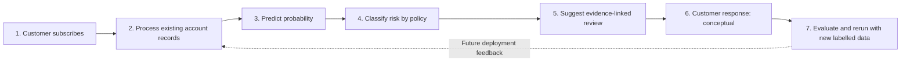

# Seven-stage customer journey

1. **Uses service:** Historical IBM records represent account subscriptions; no live usage is observed.
2. **Collects data:** The analyst loads account records. Customers are not asked to manually supply a full profile. Only recorded fields are used.
3. **Predicts risk:** Saved fitted preprocessing and models calculate churn probabilities. The probability is not certainty.
4. **Classifies:** Editable illustrative 30% and 60% boundaries assign low, medium and high risk. Changing the policy changes classification, not the fitted model.
5. **Suggests review:** Transparent recommendations reference actual account features and observed segment rates; the application sends no offers or messages.
6. **Responds:** In a real deployment a customer might accept, decline or change a plan. These outcomes are absent, so this stage is conceptual and no responses are invented.
7. **Monitors:** The prototype evaluates a fixed test set and can rerun new uploaded data. Outcome monitoring and automated learning would require additional real deployment infrastructure and independent labels.
