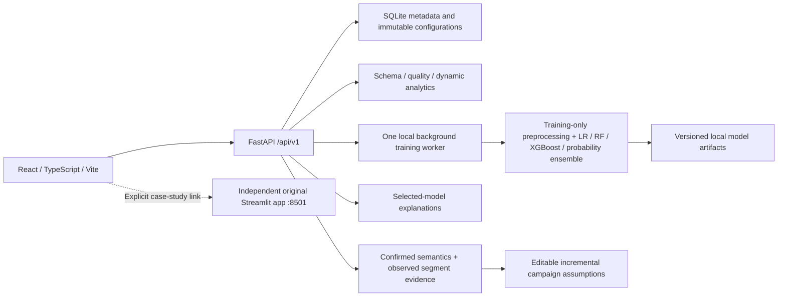

# Local architecture and isolation

The legacy `retention/` package is independent. Generic code has no imports from the IBM column allowlist and never loads its artifact. Ideas reused are the four-model method, independent held-out evaluation, soft voting, training-only calibration, transparent recommendations and incremental campaign formulas. Generic schema handling, React UI, API, SQLite snapshots/jobs, configurable catalogue, new explanations and versioned inference were developed separately.

Uploaded bytes are stored under generated IDs in `platform/runtime/datasets`. SQLite records their fingerprints, profiles and confirmed schemas. Each analysis deep-copies its configuration; later edits create new analyses rather than changing old fitted schemas. A single worker trains one expensive job at a time and persists progress/failure. Restart recovery marks interrupted jobs failed instead of reporting stale success. Model files live under `platform/runtime/models` and include exact pipelines, target mapping and fingerprints.

Bounded caches use immutable analysis IDs and file signatures; expected fingerprints and analysis identity are checked before model use. Every analysis response includes dataset and model version information. Frontend query keys include those identities and selected models. Filters affect only eligible descriptive/customer outputs, not saved evaluation cohorts.

The server binds to loopback by default. Development uses Vite's local proxy; production-style local execution serves the built SPA from FastAPI. This is intentionally a modular monolith with SQLite and local files. Multi-tenant authentication, distributed jobs, live provider feeds and automated intervention deployment are out of scope.
